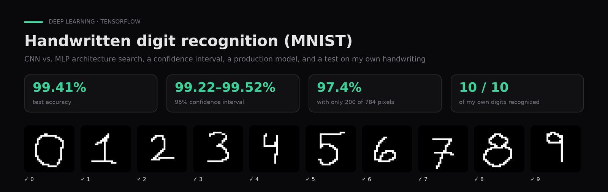

# Handwritten digit recognition (MNIST), from training to production

**Architecture search across MLPs and CNNs, a confidence interval for accuracy, a production model, and a test on digits I wrote by hand.**

`Python` · `TensorFlow` · `Keras` · `scikit-learn` · `OpenCV` · [Leer en español ↓](#español)

---

## Problem

Classify handwritten digits 0–9 and check that the model generalizes beyond the dataset.

## Data

MNIST: 70,000 28×28 grayscale images of digits 0–9 (60,000 train, 10,000 test), loaded through Keras. Plus 10 digits I drew myself to test the model outside the dataset.

## Approach

EDA, stratified splits, a 32-configuration MLP/CNN grid without Keras Tuner, a 95% Wilson CI, 200-feature selection by mutual information, retraining on train+val, and OpenCV preprocessing for my own images.

## Results

99.41% test accuracy (95% CI 99.22–99.52% for the production model), and all 10 digits I wrote by hand recognized correctly.

| Experiment | Test accuracy |
|---|---|
| Best CNN (grid of 32 MLP and CNN configurations) | **99.41%** (95% Wilson CI 99.24–99.54%) |
| Production model (retrained on train + val) | 99.39% (95% CI 99.22–99.52%) |
| Only 200 of 784 pixels (mutual-information selection) | 97.42% |
| 10 digits I drew myself (see `my_digits/`) | 10 / 10 |

## How to run

1. `pip install -r requirements.txt` (or open the notebooks in Google Colab).
2. `notebooks/01_architecture_search.ipynb`: EDA, MLP vs. CNN grid, final evaluation with a 95% CI, feature selection and the production model.
3. `notebooks/02_first_model.ipynb`: the first trained model.
4. `notebooks/03_own_digits_test.ipynb`: loads the production model and classifies the digits in `my_digits/` (upload them to `/content` in Colab). Notebook 01 saves the model as `mnist_production.keras`, while this notebook loads `mnist_model_produccion.h5`: save it under that name, or change the path in the first cell.

## Context

Coursework for **Machine Learning III** in the AI & Data Science program (Colegio Universitario IES · Universidad Siglo 21, 2025). Author: **Gaspar Quintana**.

---

## Español

**Búsqueda de arquitectura entre MLP y CNN, intervalo de confianza para la accuracy, modelo de producción y prueba con dígitos escritos a mano por mí.**

**Problema.** Clasificar dígitos del 0 al 9 escritos a mano y comprobar que el modelo generaliza fuera del dataset.

**Datos.** MNIST: 70.000 imágenes de 28×28 en escala de grises de dígitos del 0 al 9 (60.000 de entrenamiento y 10.000 de test), cargadas desde Keras. Además, 10 dígitos dibujados por mí para probar el modelo fuera del dataset.

**Método.** EDA, splits estratificados, grid de 32 configuraciones de MLP y CNN sin Keras Tuner, IC 95% de Wilson, selección de 200 variables por información mutua, re-entrenamiento con train+val y preprocesamiento con OpenCV para imágenes propias.

**Resultados.** 99,41% de accuracy en test (IC 95%, 99,22–99,52% en el modelo de producción) y los 10 dígitos que escribí a mano reconocidos correctamente.

**Contexto.** Trabajo de **Aprendizaje Automático III**, Tecnicatura en IA y Ciencia de Datos (Colegio Universitario IES · Universidad Siglo 21, 2025). Autor: **Gaspar Quintana**.
